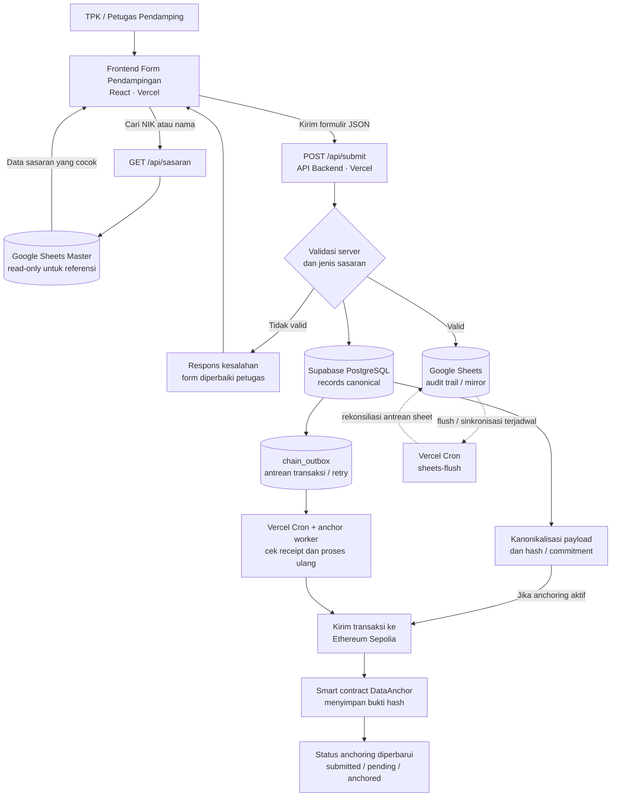
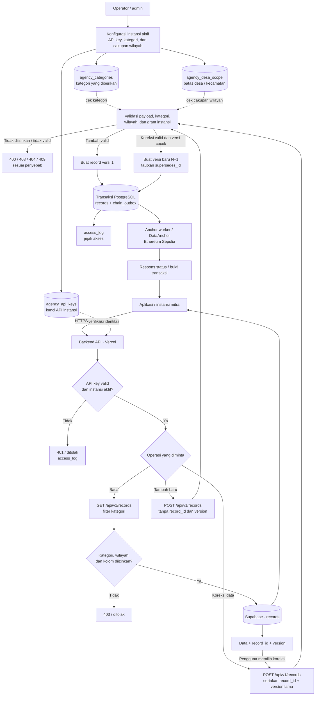

# Diagram Alur Input Data dan Integrasi Antarinstansi

Dokumen ini menjelaskan alur data dari pengisian formulir pendampingan sampai penyimpanan, audit, anchoring blockchain, serta akses data oleh aplikasi/instansi lain.

## 1. Alur utama: input sampai penyimpanan dan audit

### Ringkasan langkah

1. Petugas membuka frontend yang di-deploy di Vercel. Form dapat mencari sasaran lewat `GET /api/sasaran`; sumber pencarian berasal dari Google Sheets master yang dipakai sebagai referensi baca-saja.
2. Petugas mengisi formulir dan mengirimkannya ke `POST /api/submit`. Backend memvalidasi data sebelum memproses penyimpanan.
3. Data dicatat ke Google Sheets sebagai audit trail/mirror dan ke Supabase PostgreSQL sebagai record kanonik. Jalur audit record menyiapkan `chain_outbox` agar pekerjaan anchoring dapat dilacak dan dicoba kembali.
4. Backend menghitung hash/commitment dari payload kanonik. Ketika anchoring aktif, transaksi dikirim ke Ethereum Sepolia. Respons form dapat berstatus `submitted` dengan `tx_hash` saat transaksi masih menunggu konfirmasi.
5. Vercel Cron dan anchor worker memeriksa receipt serta memproses kembali pekerjaan yang tertunda. Bukti dapat diperiksa melalui endpoint audit yang tersedia.

**Catatan privasi:** data pribadi lengkap tetap berada di penyimpanan aplikasi. Blockchain digunakan untuk bukti hash/commitment dan metadata anchoring, bukan untuk menaruh payload pribadi mentah.

## 2. Integrasi antarinstansi: akses kategori, tambah data, dan koreksi

### Diagram alur hak akses dan operasi data

### Cara kerja penambahan data oleh instansi lain

1. Operator/admin memberikan grant kategori yang sesuai kepada instansi di `agency_categories` dan, jika dibatasi, cakupan desa/kecamatan pada `agency_desa_scope`. Instansi harus aktif dan menggunakan API key yang valid.
2. Aplikasi mitra mengirim `POST /api/v1/records` dengan payload formulir dan **tanpa** `record_id` serta `version`. Backend memvalidasi field wajib, kategori sasaran, grant kategori, dan cakupan wilayah.
3. Jika diizinkan, backend membuat record baru dengan `version = 1`, mengatribusikan penulisan kepada instansi pemanggil, lalu menyimpan record dan antrean `chain_outbox` dalam satu transaksi.
4. Proses anchoring mencatat bukti hash/commitment ke Sepolia. Kegagalan sementara di blockchain tidak membatalkan data yang sudah tersimpan; antrean dapat diproses ulang.

### Cara kerja pembaruan/koreksi data yang sebelumnya dicatat instansi lain

1. Instansi tujuan terlebih dahulu membaca data yang boleh dilihat lewat `GET /api/v1/records`, dengan filter `kategori_1` yang memang menjadi haknya. Respons menyediakan metadata seperti `record_id` dan `version`.
2. Untuk mengoreksi, aplikasi mengirim kembali payload hasil koreksi lewat `POST /api/v1/records`, dengan **`record_id` dan `version` yang hendak dikoreksi**. Kedua field itu harus dikirim bersama.
3. Backend mengecek kategori dan wilayah berdasarkan grant instansi pemanggil, memastikan versi target dapat diakses, kemudian membuat versi baru (`version = versi lama + 1`) dengan `supersedes_id` menunjuk versi sebelumnya. Baris lama **tidak ditimpa atau dihapus**.
4. Versi baru diatribusikan kepada instansi yang melakukan koreksi. Dengan begitu riwayat perubahan tetap tersedia dan bukti hash setiap versi dapat diverifikasi sendiri.

**Contoh:** Instansi B tidak otomatis bisa mengubah data kategori *Ibu Hamil* hanya karena sudah terhubung ke API. Instansi B harus memiliki grant untuk kategori tersebut dan memenuhi pembatasan wilayah. Jika tidak, penulisan ditolak sebagai `CATEGORY_NOT_GRANTED` atau `DESA_NOT_GRANTED`.

### Mekanisme integrasi dan batas akses

- **Identitas instansi:** aplikasi mitra mengirim API key pada header `X-Agency-Key` untuk endpoint ber-auth di `/api/v1/*`.
- **Baca data:** `GET /api/v1/records` mengambil record sesuai filter kategori, cakupan wilayah, dan kolom yang diizinkan.
- **Tambah atau koreksi:** `POST /api/v1/records` membuat record baru jika `record_id`/`version` tidak dikirim, atau membuat versi koreksi jika keduanya dikirim.
- **Grant kategori bukan penambahan kategori baru:** `agency_categories` memberi akses pada kategori yang sudah dikenal aplikasi. Membuat jenis sasaran baru memerlukan perubahan taksonomi, form, validasi backend, dan skema database.
- **Keamanan:** integrasi dilakukan lewat backend API, bukan melalui koneksi langsung ke Supabase atau berbagi kredensial Google Sheets.
- **Pengaturan administratif:** diagram menunjukkan konfigurasi hak akses yang dipakai backend. Diagram ini tidak menyatakan adanya endpoint publik untuk mengubah grant; perubahan grant harus melalui mekanisme operator/admin yang disiapkan proyek.

## 3. Hak akses kategori vs. penambahan jenis sasaran

Kedua hal ini berbeda:

1. **Memberi akses kepada instansi atas kategori yang sudah ada** dilakukan dengan mengatur grant kategori untuk instansi, misalnya melalui relasi `agency_categories`.
2. **Membuat jenis sasaran baru** bukan hanya menambah grant instansi. Taksonomi, pilihan formulir frontend, validasi backend, dan constraint/skema database harus diperbarui serta diuji bersama. Saat dokumen ini dibuat, daftar jenis sasaran aplikasi adalah `Catin`, `Ibu Hamil`, `Ibu Nifas`, `Baduta`, dan `Balita`.

## 4. Endpoint yang terkait

| Tujuan | Endpoint | Keterangan |
|---|---|---|
| Pencarian sasaran dari master | `GET /api/sasaran` | Jalur form publik; membaca referensi sasaran |
| Submit formulir petugas | `POST /api/submit` | Form publik; validasi, pencatatan Sheet + PostgreSQL, dan proses anchoring hybrid |
| Integrasi tulis antarinstansi | `POST /api/v1/records` | Memerlukan API key instansi dan grant sesuai aturan backend |
| Integrasi baca antarinstansi | `GET /api/v1/records` | Hanya data/kolom yang diizinkan yang dikembalikan |
| Pemrosesan antrean anchoring | `GET /api/cron/anchor` | Endpoint scheduler; harus memakai `CRON_SECRET` |
| Bukti audit on-chain | `GET /api/v1/audit/proof` | Bukti Merkle dan receipt on-chain sesuai implementasi |
| Rekonsiliasi data dan chain | `GET /api/v1/audit/reconcile` | Memeriksa kesesuaian payload dengan bukti on-chain |

## 5. Batas keamanan yang perlu dipertahankan

- Jangan menaruh API key instansi, service-account Google, `DATABASE_URL`, private key blockchain, atau `CRON_SECRET` di kode frontend maupun repositori.
- API key hanya dikirim melalui HTTPS dan diverifikasi backend.
- Jangan menganggap Google Sheets master sebagai basis record kanonik; sheet master adalah sumber referensi pencarian. Record canonical berada di PostgreSQL.
- Jangan memberi akses database langsung kepada instansi mitra. Gunakan endpoint API dengan prinsip hak akses minimum.
- Sebelum kategori sasaran baru digunakan di produksi, selaraskan perubahan frontend, backend, skema Supabase, izin instansi, dan pengujian integrasi.
