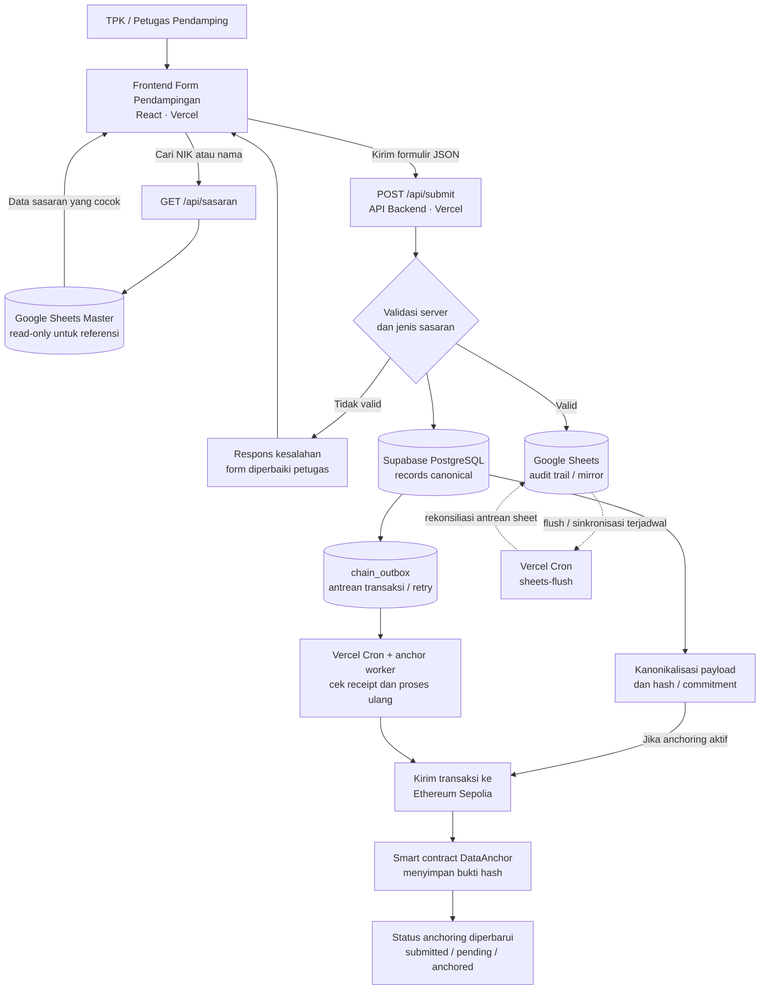
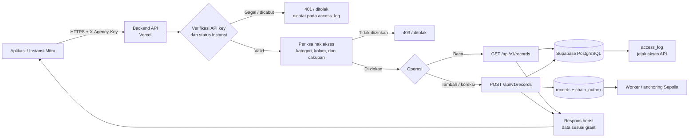

# Diagram Alur Input Data dan Integrasi Antarinstansi

Dokumen ini menjelaskan alur data dari pengisian formulir pendampingan sampai penyimpanan, audit, anchoring blockchain, serta akses data oleh aplikasi/instansi lain.

## 1. Alur utama: input sampai penyimpanan dan audit

### Ringkasan langkah

1. Petugas membuka frontend yang di-deploy di Vercel. Form dapat mencari sasaran lewat `GET /api/sasaran`; sumber pencarian berasal dari Google Sheets master yang dipakai sebagai referensi baca-saja.
2. Petugas mengisi formulir dan mengirimkannya ke `POST /api/submit`. Backend memvalidasi data sebelum memproses penyimpanan.
3. Data dicatat ke Google Sheets sebagai audit trail/mirror dan ke Supabase PostgreSQL sebagai record kanonik. Jalur audit record menyiapkan `chain_outbox` agar pekerjaan anchoring dapat dilacak dan dicoba kembali.
4. Backend menghitung hash/commitment dari payload kanonik. Ketika anchoring aktif, transaksi dikirim ke Ethereum Sepolia. Respons form dapat berstatus `submitted` dengan `tx_hash` saat transaksi masih menunggu konfirmasi.
5. Vercel Cron dan anchor worker memeriksa receipt serta memproses kembali pekerjaan yang tertunda. Bukti dapat diperiksa melalui endpoint audit yang tersedia.

**Catatan privasi:** data pribadi lengkap tetap berada di penyimpanan aplikasi. Blockchain digunakan untuk bukti hash/commitment dan metadata anchoring, bukan untuk menaruh payload pribadi mentah.

## 2. Alur integrasi aplikasi atau instansi lain

### Mekanisme integrasi

- **Identitas instansi:** aplikasi mitra menggunakan API key instansi pada header `X-Agency-Key` untuk endpoint ber-auth di `/api/v1/*`.
- **Akses baca dan tulis:** `GET /api/v1/records` untuk membaca record yang diizinkan dan `POST /api/v1/records` untuk menambah atau mengoreksi record melalui backend.
- **Hak akses:** grant kategori pada `agency_categories` menentukan kategori yang boleh diakses instansi. Pemeriksaan grant kolom mencegah kolom yang tidak diizinkan dibaca atau diekspor. Pembatasan laju permintaan diterapkan per instansi dan hasil akses dicatat pada `access_log`.
- **Penyimpanan terpusat:** integrasi dilakukan lewat API backend, bukan dengan memberikan koneksi langsung ke database atau membagikan kredensial Google Sheets kepada aplikasi mitra.
- **Audit blockchain:** record baru melalui jalur tulis API dapat masuk ke proses anchoring yang sama, sehingga bukti integritasnya dapat diverifikasi terpisah dari akses ke payload data.

## 3. Hak akses kategori vs. penambahan jenis sasaran

Kedua hal ini berbeda:

1. **Memberi akses kepada instansi atas kategori yang sudah ada** dilakukan dengan mengatur grant kategori untuk instansi, misalnya melalui relasi `agency_categories`.
2. **Membuat jenis sasaran baru** bukan hanya menambah grant instansi. Taksonomi, pilihan formulir frontend, validasi backend, dan constraint/skema database harus diperbarui serta diuji bersama. Saat dokumen ini dibuat, daftar jenis sasaran aplikasi adalah `Catin`, `Ibu Hamil`, `Ibu Nifas`, `Baduta`, dan `Balita`.

## 4. Endpoint yang terkait

| Tujuan | Endpoint | Keterangan |
|---|---|---|
| Pencarian sasaran dari master | `GET /api/sasaran` | Jalur form publik; membaca referensi sasaran |
| Submit formulir petugas | `POST /api/submit` | Form publik; validasi, pencatatan Sheet + PostgreSQL, dan proses anchoring hybrid |
| Integrasi tulis antarinstansi | `POST /api/v1/records` | Memerlukan API key instansi dan grant sesuai aturan backend |
| Integrasi baca antarinstansi | `GET /api/v1/records` | Hanya data/kolom yang diizinkan yang dikembalikan |
| Pemrosesan antrean anchoring | `GET /api/cron/anchor` | Endpoint scheduler; harus memakai `CRON_SECRET` |
| Bukti audit on-chain | `GET /api/v1/audit/proof` | Bukti Merkle dan receipt on-chain sesuai implementasi |
| Rekonsiliasi data dan chain | `GET /api/v1/audit/reconcile` | Memeriksa kesesuaian payload dengan bukti on-chain |

## 5. Batas keamanan yang perlu dipertahankan

- Jangan menaruh API key instansi, service-account Google, `DATABASE_URL`, private key blockchain, atau `CRON_SECRET` di kode frontend maupun repositori.
- API key hanya dikirim melalui HTTPS dan diverifikasi backend.
- Jangan menganggap Google Sheets master sebagai basis record kanonik; sheet master adalah sumber referensi pencarian. Record canonical berada di PostgreSQL.
- Jangan memberi akses database langsung kepada instansi mitra. Gunakan endpoint API dengan prinsip hak akses minimum.
- Sebelum kategori sasaran baru digunakan di produksi, selaraskan perubahan frontend, backend, skema Supabase, izin instansi, dan pengujian integrasi.
